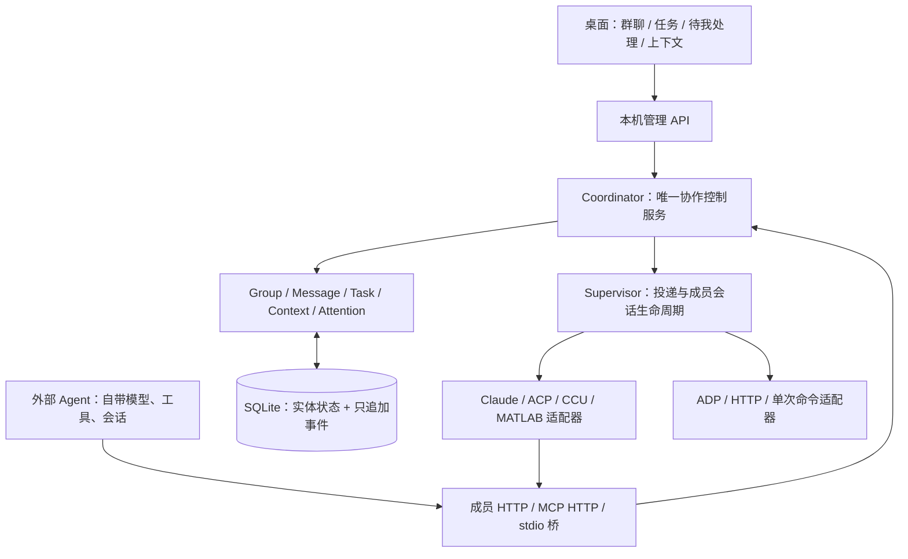

# 协作架构与 CCCC 对应

以用户下载的 `refs/cccc-main/cccc-main` 为实现依据，版本取自 `Cargo.toml`：**0.4.48**。CCU 的视觉变量、侧栏和交互密度用于界面；CCU 的 Agent 内核只在它自己作为团队成员时调用，不能决定整个工作台的协作规则。

## 控制权与数据流

同一 EXE 内启动控制服务与 WebView 窗口；逻辑边界和状态所有权分开，暂不为每层额外启动进程。成员运行器是独立进程或远端服务，不能直接修改协作数据库。远端网关与本机管理 API 使用同一个 Coordinator，避免第二份任务或消息状态。

## 对照表

以下路径均相对 CCCC 参考目录。

| CCCC 依据 | 本项目实现 | 保留的语义 |
|---|---|---|
| `docs/reference/architecture.md` 的 Group / Actor / Foreman | `core/groups.py`, `core/access.py` | 协作空间、独立成员身份、队长与同伴；身份来自接入凭据，不接受调用方冒充作者 |
| 同文档 Ownership / State Authority | `control.py`, `core/repository.py` | 单一控制服务拥有权威状态；UI、提示词和运行进程不充当数据库 |
| `crates/cccc-core/src/inbox.rs`, daemon `ops/messaging_inbox.rs` | `core/messaging.py` | 发送、请求回复、Mail；投递/已读/回复三个独立事实 |
| daemon `ops/runtime_delivery.rs`, `ops/actor_delivery.rs` | `runtime/supervisor.py` | 持久待投递项、成员内串行、启动与交付状态分离；失败不静默重放 |
| daemon `ops/runtime_session/claude.rs`, `ops/codex_voice_analyst/launch_claude.rs` | `runtime/providers/claude.py` | 一个成员拥有一个持续原生会话、原生会话 ID 和 MCP 协作通道 |
| daemon `ops/deepseek_runtime/delivery.rs`, runtime `deepseek_supervisor.rs` | `runtime/providers/acp.py` | ACP initialize/new/load/prompt/update/permission，按运行器能力恢复会话 |
| architecture 的 Context CAS 与 durable tasks | `core/groups.py`, `core/tasks.py` | 目标、约束、决定、交接、任务、成员状态的单一权威存储；版本不匹配明确失败 |
| MCP 调用映射到 daemon 操作 | `interfaces/tools.py`, `interfaces/mcp.py`, `sdk.py` | 原生工具调用直接执行同一组领域操作，不把最终自然语言当控制协议 |
| runtime bounded capture / Windows Job ownership | `runtime/processes.py` | 只拥有自己启动的子进程树，取消/退出释放；有界输出与截止时间 |

这是对上述协作原则的 Python 重写，不是 CCCC 全部功能、数据格式或私有协议的逐行移植。已有 CCCC 的验证经验不能自动等同于新实现已经获得相同可靠性；本项目单独验证下面的状态约束。

## 主动协作与消息语义

Agent 在当前运行过程中可调用 `teams_send`、`teams_task_create`、`teams_reply` 等工具。另一名成员能在原成员尚未结束时收到工作。队长不是唯一通信中转站，同伴可以直接协作。仅输出一段最终文本，不会自动产生群消息或已读回执。

- `send`：排队投递，可唤起受管理成员。
- `request_reply`：同样投递，同时独立跟踪实际关联回复。
- `mail`：留在收件箱，不主动唤起受管理成员；成员可以主动读取，外部 SDK 可以领取。
- `delivered_at`：原运行器接受输入或成员显式确认接收的证据。
- `read_at`：调用读收件箱工具或明确确认已读的证据。
- `replied_at`：实际消息的 `reply_to` 关联，不能用运行完成状态代替。

每个接收人有一条独立投递记录。外部领取获得 60 秒确认期，过期进入 `uncertain`，不会盲目重新执行。进程失败、超时、退出后未确认的投递也会暴露为不确定状态。人工重发与忽略都是持久决定；上游重复 POST 可携带稳定 `client_id`，同键不同内容会冲突。

## 消息顺序与公开执行过程

`Repository.ordered()` 返回实体首次保存的相对顺序（SQLite `records.rowid`），更新保留原位置。群聊把消息和运行条目按这个顺序合并，不按最终完成时间或电脑墙钟重新排序；原时间戳保留用于显示，支持秒级时间和完整日期提示。任务委派与普通回复使用不同样式，不能为了视觉上的先回复后委派而重写真实发送顺序。

运行器的 `emit(kind, data)` 仍由 Supervisor 接收、脱敏并持久化。新增 `runtime/progress.py` 将明确公开的文字、工具和状态投影到 `run.trace`，与正式 `message` 分开。工具用调用 ID 关联输入与结果；没有 ID 的串行桥接按名称匹配。授权通过不等于工具完成，未返回结果时不能显示成功。每次运行最多保留 80 个块、约 64,000 字符的过程，过长内容显示截断提示。

本机页面运行时每 500 ms 拉取状态，空闲时为 1.5 秒；状态快照只携带最近 6 个过程块的摘要，不带原始事件。`run.get` 获取保存的完整过程及原始事件，完成后仍可回看。历史运行最多展示最近 100 条，同时始终保留仍在执行的条目。前端 `views/runs.js` 负责显示，刷新时保留输入 DOM、中文输入法状态、光标、展开项和阅读位置。

- Claude 读取 `stream-json` 的公开文字增量及带 `tool_use_id` 的工具结果；不展示隐藏思考内容。
- ACP 使用 `toolCallId` 关联 `tool_call` / `tool_call_update`，接受部分更新及 `rawInput` / `rawOutput` / 文本内容。协议依据为 [ACP Tool Calls](https://agentclientprotocol.com/protocol/v1/tool-calls)。`session/load` 的历史回放不计作当前轮新输出或输入已接收。
- CCU 保留原内核的 `tool_call` / `tool_result` 事件；MATLAB 桥将相邻更新写成带序号的不可变事件文件，避免单一快照覆盖工具开始/结果。MATLAB 的远端 `Approved` 仅是授权结果。
- ADP 增量或替换文本按实际 SSE 返回更新。普通 HTTP/单次命令是否有中间输出取决于适配器；外部成员仍通过状态上报说明进展，不假设可读取其私有运行过程。

扩展适配器可发出 `text`（追加）、`text.replace`（按 `stream` 替换）、`status`、`tool`（`id/name/arguments/status`）和 `tool_result`（`id/result/is_error`）。未知事件不自动当成用户可见文字；只有运行器明确提供的结果才进入展示。

## 任务、上下文与人类参与

任务由负责人提交结果。依赖必须属于同一协作、形成有向无环图，而且前置任务必须 `done`。打开审核时，提交进入 `review`；只有桌面人类操作可以通过或退回。原生工具的结果不能自行批准。

共享上下文和任务变更携带读取时的 `version`。变更与相应事件在同一个 SQLite 事务提交。`records` 表按实体存当前权威状态；`events` 是只追加历史，数据库触发器拒绝更新或删除事件。**这不是仅靠重放事件恢复全部状态的系统**，备份必须包含整个数据库。

人类提问是持久异步事项，答复进入请求者收件箱。运行器工具授权由 `core/permissions.py` 按人类配置的策略处理：手动模式保持等待；自动允许/拒绝模式直接作出决定并记录执行事件。修改策略也能原子地处理已经等待的工具请求，已由人答复的请求不会被覆盖。拒绝/超时/程序退出不会视为同意；业务提问和交付审核不经过工具策略。所有审核与答复集中在“待我处理”，并在所在协作侧栏显示。

## 运行器接入与成员分身

沿用 CCCC 中“Actor 身份拥有自己的运行会话”的边界。`core/profiles.py` 管理可复用的成员设定：原始 `agents` 条目仍是接入配置，分身只保存 `source_id` 和名称、职责、工作说明等个人设定。`Config.agent()` 在使用时解析共享的运行配置与凭据来源，`Config.public()` 提供界面所需的来源名称及有效权限，不暴露明文凭据。

分身不复制 provider ID、运行历史或成员接入凭据；会话键仍是 `group_id + actor_id`，会话代数和进程由现有 Supervisor 管理。`runtime/prompting.py` 每轮把本成员的职责与工作说明注入投递上下文；其他成员只收到 roster 中的职责。来源运行配置改变时，先拒绝存在活动运行的变更，再关闭相关缓存进程；原有环境指纹检查仍要求明确新建会话。

`AdapterSpec.capabilities.profiles` 显式声明分身能力，未声明则拒绝。ADP 使用 `opt_in`：应用支持角色覆盖时才开放，并将设定传为 `SystemRole`，按成员与会话代数区分 `ConversationId`。通用外部接口不因名字相同就被假设具有独立会话能力。新增适配器应验证原运行器的会话隔离后再声明此能力。

工具策略优先级为分身覆盖 → 来源成员覆盖 → 全局默认。修改权限不改变原生会话指纹或重启进程，`approve()` 在每个请求及等待期间读取最新策略。Claude 始终以原生 default permission mode 启动，由协议回调交给工作台处理；不通过启动 bypass 模式模拟动态策略。原运行器已允许/禁止、未提交到回调的操作仍由原生规则决定。

## 会话所有权与恢复

`group_id + actor_id` 唯一标识一个成员会话；`generation` 区分人类明确新建的会话；`provider_id` 是原运行器的会话标识。成员之间、协作之间不会共享原生会话。

- Claude：持续 `stream-json` 双向进程和原生 `--session-id / --resume`；与 CCCC 当前 Claude background daemon 的具体传输不同，但保留会话所有权及原生 MCP 协作语义。
- ACP / DeepSeek：保持 ACP 进程和 session ID；优先使用声明的 `sessionCapabilities.resume`，否则使用 `loadSession`，都未声明则明确要求新建。`deepseek_config.py` 将 Web 模型设置通过受管理的启动补丁衔接到 ACP，不复制 Web 插件树，不读取凭据仓库。完成过轮次的会话保留原模型；失败的首轮可按当前配置重新选择服务端提供的模型选项。
- CCU：驻留原 `Runtime/Agent`，保留它的领域工具与能力路由；额外把团队工具放进可用工具集；使用原 Session 存储。
- MATLAB：驻留协调 MATLAB 与原 `autoagent.Runner` worker；每轮传入持久的原生消息历史，协作工具调用由桥接返回统一控制服务。
- 外部系统：原系统拥有模型、进程、会话与调度，工作台只记录它报告的状态。90 秒无活动心跳标为离线。
- ADP/HTTP：会话取决于提供方；文本输出转成显式 `adapter_response`，不宣称拥有原生团队工具。单次命令没有原生持续会话。

启动配置、工作目录或 CCU 配置文件发生变化时，不把旧会话悄悄接到新环境；需要明确新建会话。会话元数据更新带 generation 检查。重启不自动重放已开始的调用，历史 provider ID 保留给后续恢复。

## 模块阅读顺序

| 路径 | 职责 |
|---|---|
| `__main__.py`, `config.py` | 用户目录、单实例、配置、桌面与 CLI 生命周期、凭据保护 |
| `control.py` | 服务组合和统一操作入口，不实现模型循环 |
| `core/contracts.py`, `repository.py`, `access.py` | 公共类型、持久化边界、身份权限 |
| `core/groups.py`, `messaging.py`, `tasks.py`, `attention.py`, `sessions.py` | 独立领域服务 |
| `core/profiles.py`, `permissions.py` | 分身能力检查、共享接入引用、工具确认策略及继承 |
| `runtime/supervisor.py`, `prompting.py`, `processes.py` | 调度、投递上下文、进程所有权与取消 |
| `runtime/progress.py`, `web/views/runs.js` | 公开过程的有界投影、实时展示与历史回看 |
| `runtime/registry.py`, `runtime/providers/` | 适配器注册、能力说明、字段描述和供应商协议 |
| `interfaces/http.py`, `gateway.py`, `mcp.py`, `tools.py` | 传输和工具契约；复用领域操作 |
| `bridges/` | 调用用户原 CCU/MATLAB 内核的桥接；不改原工程 |
| `sdk.py` | 可单文件分发的标准库 Python 客户端 |
| `web/app.js`, `dialogs.js`, `views/`, 按组件拆分的 CSS | 页面状态/交互、弹窗、功能视图、视觉层 |

旧 `engine.py` / `server.py` 只有薄兼容别名，不保存第二套实现。0.1 的单文件编排器和终态 JSON 动作解析已从活动源码移除，原版保存在压缩备份中。

扩展通常优先使用现有 MCP/HTTP/ACP 边界；确需新运行协议时，实现适配器 `run(prompt, turn, stop, emit, approve)`、`close()` 和会话 `persist()` 回调，注册一个 `AdapterSpec` 即可。前端接入表单来自注册信息，无需为每个供应商复制一套页面。

## 有意保留的边界

没有复刻 CCCC 的 PTY/完整终端、多 Scope、Group Space、媒体、IM、移动端、云端账号和自动化系统。共享目录不自动提供并发文件冲突解决。任务数量限制 500，消息正文上限 100000 字符；这是内部桌面核心版，不是高并发多租户服务。

配置使用用户文件；协作数据库为 `collaboration.db`；原生会话文件由工作台或原运行器保存。迁移只读导入 `teams.db`、保留原文件，不能在缺少运行证据时把旧 job 状态升级成已读/回复事实。
